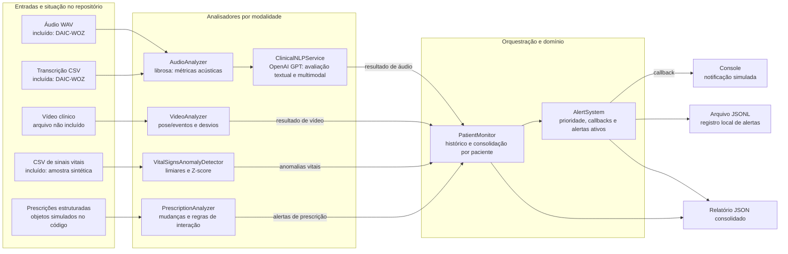
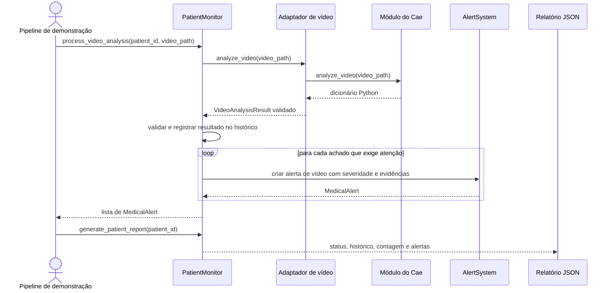
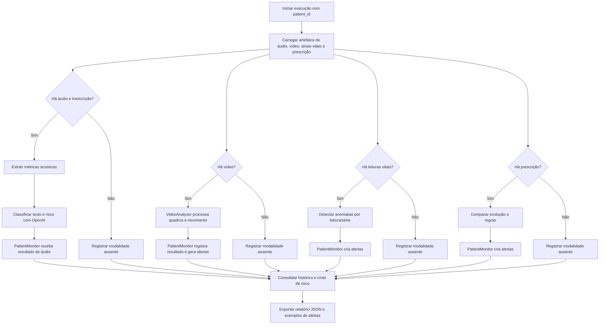

# Arquitetura e System Design

## 1. Objetivo e escopo

Este documento descreve a arquitetura do Tech Challenge Fase 4 para uma pipeline demonstrável de monitoramento multimodal. A solução processa áudio clínico, vídeo clínico, sinais vitais e prescrições, consolida achados e produz alertas e um relatório JSON.

O escopo considera OpenAI GPT aceitável e não depende de serviços Azure. Não há requisito de interface gráfica na proposta; a entrega principal é uma pipeline executável e seus artefatos de saída.

O sistema é um protótipo acadêmico para demonstração. Seus resultados são sinais de apoio e não constituem diagnóstico ou recomendação clínica autônoma.

## 2. Estado atual e direção arquitetural

O repositório já contém componentes para análise acústica e textual, detecção de anomalias em sinais vitais, análise simplificada de evolução de prescrições, alertas e monitoramento por paciente. A etapa 1 conecta esses componentes pelo comando `tech-challenge4`, com validação offline reproduzível. O aceite real da etapa 2 permanece pendente.

O desenho-alvo mantém cada modalidade em um analisador especializado. O `PatientMonitor` atua como orquestrador e encaminha resultados normalizados ao `AlertSystem`, que mantém os alertas durante a execução e permite exportar um relatório JSON. A consolidação reúne evidências por paciente e usa a maior prioridade entre alertas reais; alertas simulados não entram no risco. Sem alertas reais e com avaliação incompleta, o risco é `INDETERMINADO`. O sistema não produz uma nova avaliação clínica conjunta entre modalidades.

| Componente | Implementação encontrada | Direção deste desenho |
|---|---|---|
| Áudio | `src/audio_analisys/`: métricas acústicas com librosa, transcrição de arquivo do DAIC-WOZ e análise textual via OpenAI. | Preservar a saída estruturada e encaminhá-la ao monitor central. Whisper não é necessário: a transcrição vem do dataset. |
| Sinais vitais | `src/anomaly_detection/vital_signs_detector.py`: limiares e Z-score; calcula variação recente, mas ela não gera alerta por si só. | Usar limiares e Z-score como critérios de alerta. |
| Prescrições | `src/anomaly_detection/prescription_analyzer.py`: comparação de prescrições, regras de interação e limites simplificados de dose. | Tratar como regras demonstrativas e explicitar a cobertura limitada. |
| Monitor | `src/anomaly_detection/patient_monitor.py`: consolida entradas, histórico e relatório. | Tornar o ponto único de integração dos resultados de modalidade. |
| Alertas | `src/anomaly_detection/alert_system.py`: priorização, callbacks e histórico em memória. | Exibir no console e registrar em JSONL local; notificação externa fica fora do protótipo. |
| Vídeo | `video_integration.py` define protocolo único, adaptador validado e stub; o monitor registra resultados e gera alertas. | O analisador de vídeo é uma dependência a receber da frente de vídeo. A integração está preparada e validada com substitutos; falta validar o módulo real. |

## 3. Diagrama visual da arquitetura



**Estado das entradas:** existem seis arquivos WAV e seis transcrições CSV do DAIC-WOZ para os participantes 303, 304, 306, 307, 320 e 321. Há também uma amostra sintética de sinais vitais em `src/anomaly_detection/data/sinais_vitais_demo.csv`, consumida pela demonstração de detecção. Não encontrei arquivos de vídeo clínico nem arquivos de prescrições. As duas prescrições fixas são criadas em `src/tech_challenge4/demo_inputs.py`. O adaptador, o caminho de vídeo até alertas e o registro JSONL estão implementados. A análise com o módulo e o vídeo reais do Cae permanece pendente.

## 4. Componentes e responsabilidades

### 4.1 Entrada e identificação do paciente

Cada execução processa um único identificador de paciente e seus artefatos disponíveis. Um novo `PatientMonitor` deve ser criado a cada execução, e o mesmo identificador deve ser usado em todas as modalidades. Essa restrição evita misturar pacientes no histórico de sinais vitais que hoje é compartilhado pelo detector. O processamento de vários pacientes em uma mesma instância fica fora deste protótipo.

Na demonstração inicial, os arquivos de áudio são organizados por participante DAIC-WOZ; o vídeo e os dados clínicos de exemplo precisam ser associados explicitamente ao mesmo identificador demonstrativo. Não se deve inferir que o ID do dataset representa um paciente real da demonstração.

### 4.2 Análise de áudio

`AudioAnalyzer` calcula energia RMS, medidas de pitch e proporção de pausas a partir do áudio e dos intervalos de fala indicados na transcrição. `ClinicalNLPService` envia métricas e transcrição à API da OpenAI e espera uma resposta JSON com riscos, sintomas identificados e recomendação de triagem.

A demonstração usará áudio e transcrição pareada fornecidos pelo dataset. Transcrição automática de gravações novas não será implementada nesta entrega; essa é uma limitação em relação ao enunciado. A dependência não utilizada `openai-whisper` foi removida. `--openai-stub` permite simular apenas a resposta textual, mantendo extração acústica e leitura da transcrição reais e marcando o resultado e os alertas como simulados. Se a chamada à OpenAI falhar ou a chave estiver ausente, registrar a falha do áudio e continuar as outras modalidades, gerando relatório com execução parcial.

### 4.3 Análise de vídeo

O analisador de vídeo recebe um caminho de vídeo e retorna um estado e uma lista estruturada de achados. Duração, quadros, medições posturais e outros detalhes são opcionais quando disponíveis.

### Decisão: analisador desacoplado com contrato compartilhado

A implementação do analisador de vídeo será um módulo independente, desenvolvido pela frente de vídeo. Ele não deve importar nem depender de `PatientMonitor` ou `AlertSystem`; sua responsabilidade termina ao analisar o vídeo e devolver um resultado estruturado. O monitor recebe a implementação por injeção de dependência e converte seus achados em registros e alertas.

O módulo do Cae deve expor `analyze_video(video_path)` e devolver exatamente um dicionário Python no formato descrito na seção 5. O responsável pela integração fornecerá um adaptador que valida esse dicionário e o converte para o tipo interno usado pelo `PatientMonitor`. O protocolo único `VideoAnalyzerProtocol` e o tipo `VideoAnalysisResult` estão definidos em `video_integration.py`. A implementação do Cae deve seguir a interface acordada.

Os achados devem conter tipo, descrição e severidade, além de evidências disponíveis. Uma execução concluída sem anomalias deve ser distinguível de uma falha de processamento; falhas nunca devem ser apresentadas como uma lista vazia de anomalias.

Enquanto a implementação do Cae não estiver disponível, um stub conforme ao mesmo contrato permitirá desenvolver e demonstrar o restante do sistema. O stub pode gerar alertas para demonstrar a integração; seus resultados e alertas devem estar identificados como simulados em todas as saídas.

### 4.4 Sinais vitais

`VitalSignsAnomalyDetector` analisa frequência cardíaca, pressão, SpO₂, temperatura e frequência respiratória. Os critérios de alerta serão limiares estáticos e Z-score calculado com o histórico local. O código atual calcula uma variação recente, mas ela não gera alerta por si só; não será apresentada como terceiro detector.

Apesar da descrição no docstring, não há implementação de Isolation Forest no código analisado. O histórico do detector é mantido em memória; para a demonstração, o monitor deve ser instanciado e alimentado de forma consistente para preservar a janela temporal.

A validação de células rejeita ausentes, não numéricas, não finitas e valores fora das faixas demonstrativas de `POSSIBLE_RANGES`, registrando erros sem descartar as outras medições válidas. SpO₂ de 100% é normal e valores acima de 100% são erros de dados. Com histórico constante, o Z-score fica indisponível (`null`), a mudança é preservada em `history_change` e nenhum alerta estatístico adicional é criado; os limiares estáticos continuam aplicados. Qualquer erro de dados mantém a modalidade parcial, mesmo após leituras válidas posteriores.


### 4.5 Prescrições

A demonstração utilizará pelo menos duas prescrições sintéticas fixas, do mesmo paciente e em momentos diferentes, criadas no código. `PrescriptionAnalyzer` compara prescrições e aplica listas locais simplificadas para interações medicamentosas e limites de dose. As listas não equivalem a uma base farmacológica abrangente. Os alertas devem ser apresentados como resultado das regras implementadas, sem alegar cobertura clínica completa.

### 4.6 Orquestração, alertas e relatório

`PatientMonitor` mantém o histórico de análises por paciente, encaminha achados ao `AlertSystem` e gera relatório consolidado. `AlertSystem` mapeia severidade para prioridade, armazena alertas em memória e oferece callbacks e exportação JSON.

### Decisão de emissão de alertas para a demonstração

Como não haverá um serviço externo para receber notificações, a demonstração usará saídas locais:

- **Console:** um callback exibe o alerta quando ele é criado. A entrega à equipe médica é simulada; cada alerta também deve indicar se seu achado de origem é simulado.
- **Arquivo JSONL:** cada alerta será acrescentado como um objeto JSON em uma linha, permitindo preservar o histórico entre execuções. O registro deve incluir pelo menos ID, paciente, origem, prioridade, título, mensagem, horário, status e detalhes/evidências.
- **Relatório JSON:** a exportação consolidada também inclui os alertas da execução.

Essas saídas demonstram detecção, emissão e registro local. Não representam entrega do alerta à equipe médica. A apresentação e o relatório devem explicitar essa limitação. O `LocalAlertSink` recebe callbacks do `AlertSystem`, mostra os alertas completos no console e acrescenta cada alerta ao JSONL. Falhas de abertura, escrita e fechamento são registradas para o relatório e o código de saída. Um adaptador de saída separado do `AlertSystem` pode permitir conectar um receptor externo no futuro sem alterar os analisadores.

Cada alerta recebe um UUID da biblioteca padrão do Python, evitando a repetição de IDs entre execuções. Se a gravação do JSONL falhar, a execução continua e o relatório registra a falha, mas o comando retorna código diferente de zero. Se o relatório não puder ser salvo, o erro é mostrado no console e o comando também retorna código diferente de zero. A execução retorna código zero quando o processamento e as gravações terminam operacionalmente, mesmo se o relatório indicar execução parcial.

Persistência em banco de dados, integração com prontuário, fila e canal externo de notificação estão fora do escopo desta demonstração.

## 5. Fluxo de integração de vídeo

O fluxo-alvo abaixo separa as responsabilidades: a frente de vídeo fornece um analisador executável e seus resultados; o responsável por este system design conecta esse analisador ao `PatientMonitor`, converte achados em alertas e inclui os resultados no relatório.



### Contrato mínimo de integração

O contrato abaixo está implementado pelo adaptador de integração. O módulo do Cae é independente do monitor e dos alertas. Ele devolve um dicionário Python com os campos abaixo; o adaptador da integração o converte para o resultado tipado usado internamente. Não se exige análise de objetos além daquela escolhida para o módulo.

O monitor recebe `process_video_analysis(patient_id: str, video_path: str)` e chama `analyze_video(video_path: str) -> VideoAnalysisResult`. O identificador e o caminho são obrigatórios e não vazios; o monitor associa o resultado ao paciente. A configuração de modelos pertence ao analisador.

| Campo do resultado | Tipo | Obrigatório | Significado |
|---|---|---|---|
| `status` | texto | Sim | `CONCLUIDA`, `INCONCLUSIVA` ou `SIMULADA`. |
| `findings` | lista | Sim | Achados que devem gerar alertas; pode estar vazia. |
| `summary` | texto | Condicional | Resumo; obrigatório com motivo quando o resultado for `INCONCLUSIVA`. |
| `duration_seconds` | número | Não | Duração do vídeo, se disponível. |
| `frames_analyzed` | inteiro | Não | Quantidade de quadros analisados, se disponível. |

Cada achado contém `type` e `description` como textos não vazios e `severity` como um dos valores abaixo. `offset_seconds` (segundos desde o início do vídeo), `frame_number` (quadro original, iniciando em zero), `confidence` (de 0 a 1), ângulos e outras evidências são opcionais. Não se deve inventar data de gravação ou confiança que o analisador não forneça.

| Severidade | Prioridade do alerta |
|---|---|
| `CRITICO` | `P1_CRITICAL` |
| `ALTO` | `P2_HIGH` |
| `MEDIO` | `P3_MEDIUM` |
| `BAIXO` | `P4_LOW` |

O monitor cria um alerta `VIDEO_ANALYSIS` por achado de resultado `CONCLUIDA`. Uma análise `INCONCLUSIVA` é registrada com seu motivo, sem gerar alerta clínico. Um stub pode retornar `SIMULADA` com achados para demonstrar a integração: cada alerta derivado deve conter `simulated: true` no console, JSONL e relatório. Ele não representa uma detecção real. Alertas de resultados reais devem conter `simulated: false`.

Se o vídeo não permitir a avaliação, por exemplo pela ausência de pessoa no enquadramento, o módulo retorna `INCONCLUSIVA`, `findings: []` e o motivo em `summary`. Cae deve documentar a regra que define cada desvio e informar sua severidade usando os valores da tabela. O adaptador valida o resultado; o monitor converte a severidade para a prioridade existente.

Alertas simulados aparecem nas saídas de demonstração, mas não entram no cálculo do risco real do paciente. Se faltarem resultados reais necessários, o relatório deve mostrar que a avaliação está incompleta, mesmo que não existam alertas reais.

O analisador sinaliza arquivo inexistente, formato inválido ou falha de processamento por exceção com mensagem. O monitor captura a falha e registra o vídeo como `FALHA` no relatório. Resultado inválido, incluindo severidade desconhecida, também é falha; não deve receber silenciosamente uma prioridade padrão. Se não houver analisador configurado, o estado é `NAO_INTEGRADO`. Nenhuma dessas condições equivale a uma análise concluída sem achados.

Exemplo ilustrativo do resultado serializado:

```json
{
  "status": "CONCLUIDA",
  "findings": [
    {
      "type": "DESVIO_POSTURAL",
      "description": "Inclinação do tronco acima do limite configurado.",
      "severity": "MEDIO",
      "offset_seconds": 12.5,
      "frame_number": 375,
      "confidence": 0.87
    }
  ],
  "summary": "Um desvio postural requer revisão."
}
```

Nesse exemplo, o monitor associa o achado ao paciente da chamada e cria um alerta `P3_MEDIUM`. O código usa um único `VideoAnalysisResult` e um único protocolo compartilhado, conforme o contrato acima. Até a entrega do módulo real, o stub permite demonstrar o caminho completo com a identificação `SIMULADA`.

Para a demonstração final, a frente de vídeo deve fornecer um vídeo de exemplo, o movimento e a regra avaliados e o instante esperado do desvio. Um exemplo sem desvio pode complementar a demonstração. Áudio, vídeo e dados sintéticos serão associados a um identificador fictício; isso não significa que pertençam ao mesmo paciente real.

## 6. Dados e formato do relatório

O artefato de saída deve ser JSON serializável e conter, no mínimo:

`execution_status` assume `COMPLETA` ou `PARCIAL`. `risk_level` usa `ESTAVEL`, `ATENCAO`, `ALERTA`, `CRITICO` ou `INDETERMINADO`; este último representa falta de evidência suficiente e está implementado no enum do monitor.

```json
{
  "patient_id": "PAC-DEMO-001",
  "report_timestamp": "ISO-8601",
  "execution_status": "COMPLETA",
  "current_status": {
    "risk_level": "ATENCAO",
    "audio_analysis": "concluida",
    "video_analysis": "concluida",
    "vital_signs": "1 alerta",
    "prescriptions": "OK"
  },
  "findings": {
    "audio": {},
    "video": {},
    "vital_signs": [],
    "prescriptions": []
  },
  "alerts": [
    {
      "id": "uuid",
      "patient_id": "PAC-DEMO-001",
      "source": "VITAL_SIGNS",
      "priority": "P2_HIGH",
      "title": "Exemplo de alerta",
      "message": "Descrição do achado",
      "timestamp": "ISO-8601",
      "simulated": false,
      "details": {}
    }
  ],
  "limitations": []
}
```

O formato acima é a apresentação consolidada desejada; o `generate_patient_report` inclui resultados completos de áudio e vídeo, medições válidas, erros de dados e evidências de prescrição. `alerts` é uma lista de alertas completos; contagens, se mantidas, ficam em um campo separado, como `alert_summary`. O relatório indica execução completa ou parcial, estados e falhas das modalidades e se cada alerta é simulado. O relatório ampliado do `PatientMonitor` mantém os achados necessários e os alertas completos, reaproveitando sua exportação JSON.

Uma execução é `COMPLETA` quando áudio e transcrição do dataset foram processados com uma chamada real à OpenAI, o vídeo real foi processado, sinais vitais e duas prescrições foram avaliados e as saídas foram gravadas. Modalidade ausente, falha, dados inválidos, análise inconclusiva, uso do stub ou falha de gravação tornam a execução `PARCIAL`. Alertas reais encontrados continuam no relatório com suas prioridades, mesmo em execução parcial. Sem alertas reais e com dados insuficientes, o risco é `INDETERMINADO`, não estável. A avaliação também deve indicar que está incompleta quando houver alertas reais em uma execução parcial. Falha operacional ao gravar as saídas torna o comando não bem-sucedido e retorna código diferente de zero.

Para cada achado, preservar origem, timestamp, valor ou evidência, severidade, confiança quando disponível e regra/modelo que o produziu. Isso permite explicar no relatório como o alerta foi formado.

## 7. System design: execução ponta a ponta



Se uma modalidade falhar, as outras continuam e o relatório é gerado como execução parcial, identificando a falha. A demonstração completa exige sucesso nas modalidades necessárias, inclusive vídeo real; o stub permite apenas demonstrar a integração. Este desenho representa processamento por execução para a demonstração. Embora o enunciado mencione monitoramento em tempo real, o código atual não implementa ingestão contínua, persistência ou infraestrutura de streaming. O sistema deve ser descrito como pipeline demonstrativa, a menos que esses recursos sejam adicionados.

O comando retorna código zero quando termina o processamento e grava as saídas, mesmo se a execução estiver `PARCIAL` por dados ausentes, falha de modalidade, análise inconclusiva ou uso do stub. Falhas operacionais, incluindo não conseguir gravar o relatório ou o JSONL, retornam código diferente de zero e são informadas no console.

## 8. Configuração e operação

Requer Python 3.14+ e `uv`. Instalar com `uv sync --frozen`.

```bash
uv run tech-challenge4 --patient-id PAC-DEMO-001 \
  --audio-dir src/audio_analisys/data/daicwoz/303_P \
  --openai-stub --video-stub
```

Esse comando faz extração acústica real e usa a transcrição DAIC-WOZ. Apenas a resposta OpenAI e o resultado do vídeo são simulados. O resultado esperado é `PARCIAL`, com alertas simulados excluídos do risco e risco real `CRITICO` pela leitura sintética de pressão sistólica de 180 mmHg.

Para OpenAI real, configurar `OPENAI_API_KEY` no ambiente ou `.env` e omitir `--openai-stub`. O modelo usado é `gpt-4o-mini`. Para vídeo real, instalar o módulo e suas dependências e usar `--video /caminho/video.mp4 --video-analyzer modulo_cae:analyze_video`. Sem vídeo/analisador, registrar `NAO_INTEGRADO`. Não há dependência Azure.

Entradas padrão: CSV sintético distribuído em `anomaly_detection/data/sinais_vitais_demo.csv` e duas prescrições fixas cronológicas em `tech_challenge4/demo_inputs.py`. `--vitals-csv PATH` permite sobrescrever o CSV. Saídas: `output/report.json` (substituição) e `output/alerts.jsonl` (acréscimo), configuráveis com `--report PATH` e `--alerts PATH`. Os caminhos devem ser distintos. Horários de emissão usam o relógio local do processo; sinais e prescrições preservam os timestamps de entrada.

O pacote distribui os módulos irmãos `tech_challenge4`, `audio_analisys` e `anomaly_detection`. A transcrição automática e sua dependência Whisper não são necessárias. A execução cria um novo monitor por paciente.

Verificação: `uv run python -m unittest discover -s tests -v` e `uv build --wheel`. A suíte testa estados de vídeo, função externa, entradas inválidas, histórico constante, evolução de prescrições, risco, UUIDs, persistência e códigos de saída. O comando offline acima exercita os arquivos reais de áudio e transcrição. Testes com serviços substitutos não constituem aceite da etapa 2.

## 9. Etapas e pendências para concluir o sistema

O aceite ocorre em duas etapas. Na **etapa 1**, a pipeline offline deve executar de forma reproduzível com resposta OpenAI simulada e stub de vídeo, gerar JSON e JSONL válidos e marcar o relatório como `PARCIAL`; essa parcialidade é esperada e não torna a execução operacional malsucedida. Na **etapa 2**, o aceite final exige chamada real à OpenAI, módulo e vídeo reais do Cae e execução `COMPLETA`.

Todo o código de integração, incluindo contrato, adaptador, carregamento do módulo, monitor, alertas e relatório, será implementado e validado com uma implementação substituta na etapa 1, antes da entrega do Cae. Desde que o módulo recebido cumpra o contrato acordado, a etapa 2 exigirá apenas sua instalação e configuração e a validação com os artefatos reais, sem desenvolver novos componentes de integração.

Os quatro passos de implementação da etapa 1 estão entregues em branches encadeadas:

| Passo | Branch | Resultado |
|---|---|---|
| 1 | `feature/passo-1-execucao-integrada` | CLI, empacotamento, entradas sintéticas e caminhos de saída |
| 2 | `feature/passo-2-integracao-video` | Contrato único, adaptador, stub, estados e alertas de vídeo |
| 3 | `feature/passo-3-demais-modalidades` | Áudio real, resposta offline opcional, sinais validados e prescrições |
| 4 | `feature/passo-4-alertas-relatorio` | UUID, console/JSONL, risco, relatório, falhas e documentação |

Permanecem pendentes o aceite real da etapa 2 e a preparação da apresentação de até 15 minutos com os artefatos reais. A implementação acústica não é eGeMAPS, a detecção de sinais vitais não usa Isolation Forest, as regras de prescrição são limitadas e os dados DAIC-WOZ não validam por si só o cenário de saúde pós-parto.

Para a etapa 2, receber do Cae a implementação que segue o contrato, suas regras de detecção e um vídeo de exemplo com resultado esperado; instalar o módulo e suas dependências, configurar sua função no comando e validar a execução real.

## 10. Critério de conclusão da integração

**Aceite da etapa 1:** uma execução offline reproduzível usa resposta OpenAI simulada e stub de vídeo, processa as entradas disponíveis, registra os alertas simulados e reais corretamente e exporta JSON e JSONL válidos. O relatório da execução é `PARCIAL` devido ao stub.

**Aceite final da etapa 2:** uma única execução, com um mesmo `patient_id`, processa ao menos um exemplo real de áudio e vídeo, a transcrição fornecida pelo dataset e exemplos sintéticos de sinais vitais e prescrição; usa uma chamada real à OpenAI; registra todos os resultados no monitor; cria alertas para os achados configurados; e exporta um JSON que permita rastrear cada alerta até sua modalidade e evidência de origem. A execução deve ser `COMPLETA`.
